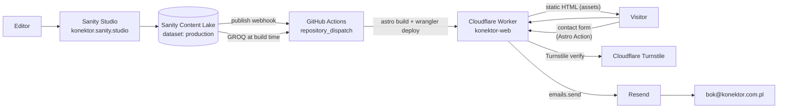

# Konektor – Implementation Plan

New **konektor.com.pl** (replacing the current Webflow site) built with **Astro 7 + Sanity 6**, hosted on **Cloudflare Workers**, transactional email via **Resend**.

> [!NOTE]
> Repo scaffold is done (this commit). The UI/design phase is intentionally deferred – all components render unstyled semantic HTML so the data flow is testable end-to-end.

## 1. Architecture



| Concern | Decision | Why |
|---|---|---|
| Rendering | `output: 'static'` – every page prerendered; only the Action endpoint runs on the Worker | Fastest TTFB, ~zero runtime cost, nothing to break |
| Content freshness | Sanity webhook → GitHub `repository_dispatch` → rebuild (~1–2 min) | Content changes a few times a month; full SSG is simplest |
| Hosting | Cloudflare **Workers** + Static Assets (`@astrojs/cloudflare` v14) | Pages is in maintenance mode; Workers is the current target of the adapter |
| CMS | Sanity, Studio hosted on `konektor.sanity.studio` (separate workspace `studio/`) | Keeps React/Studio out of the site bundle; free hosting |
| Images | Sanity Image CDN via `@sanity/image-url` (adapter `imageService: 'passthrough'`) | No Worker image transforms needed |
| Forms | Astro Actions + zod validation → Resend; Turnstile + honeypot | Type-safe, no 3rd-party form service |
| Email | Resend, domain `konektor.com.pl`, EU region | DKIM/SPF on `send.` subdomain – doesn’t touch existing mailbox MX |
| Repo | npm workspaces monorepo: `web/` + `studio/` | One repo, shared TS types via Sanity TypeGen |

## 2. Repository layout

```
Konektor/
├─ package.json              # npm workspaces + root scripts
├─ .github/workflows/
│  ├─ deploy-web.yml         # check → build → wrangler deploy (push, PR preview, Sanity webhook)
│  └─ deploy-studio.yml      # sanity deploy on studio/** changes
├─ docs/  IMPLEMENTATION_PLAN.md, SETUP.md
├─ studio/                   # Sanity Studio v6
│  ├─ sanity.config.ts       # structure tool, vision, singleton guards
│  ├─ sanity.cli.ts          # studioHost: konektor
│  ├─ sanity-typegen.json    # → web/src/sanity/sanity.types.ts
│  ├─ structure.ts           # Polish desk structure
│  └─ schemaTypes/{documents,objects}/ + sections.ts
└─ web/                      # Astro 7 site
   ├─ astro.config.mjs       # cloudflare adapter, sitemap, astro:env schema
   ├─ wrangler.jsonc         # Worker name, compat flags, custom domains
   ├─ public/_headers, _redirects, favicon.svg
   └─ src/
      ├─ actions/index.ts    # `contact` action → Turnstile → Resend
      ├─ lib/emails.ts       # notification + auto-reply templates
      ├─ sanity/             # client, image builder, GROQ queries, generated types
      ├─ layouts/BaseLayout.astro   # SEO/meta, header, footer (unstyled)
      ├─ components/         # SectionRenderer, PortableText, ContactForm
      └─ pages/              # index, [slug], serwisy/[slug], 404, robots.txt
```

## 3. Content model (mirrors the current site)

| Type | Kind | Route / usage |
|---|---|---|
| `siteSettings` | singleton | Company data (phone, e-mail, address, NIP), logo, footer tagline, **form recipients**, default SEO |
| `homePage` | singleton | `/` – page-builder sections |
| `page` | collection | `/o-firmie`, `/certyfikaty`, `/kontakt`, `/polityka-prywatnosci`, `/cookies` … |
| `service` | collection | `/serwisy/<slug>` – hero, 3 benefits, sections, SEO; also feeds nav + form “Usługa” select |
| `certificate` | collection | Certificates grid (image + PDF) |
| `clientLogo` | collection | “Zaufali nam” logo strip |

**Page-builder sections:** `heroSection`, `featuresSection`, `textImageSection`, `servicesSection` (auto-lists services), `statsSection`, `timelineSection` (Nasza historia), `logosSection`, `certificatesSection`, `faqSection`, `contactSection`, `ctaSection`, `richTextSection`.

**Services to create (keep existing slugs for SEO):**
`systemy-sygnalizacji-pozaru`, `dzwiekowe-systemy-ostrzegawcze`, `systemy-sygnalizacji-wlamania-i-napadu`, `systemy-kontroli-dostepu`, `systemy-monitoringu-wizyjnego`, `gasnice-i-hydranty`.

## 4. Phases

| # | Phase | Deliverables | Status |
|---|---|---|---|
| 0 | **Scaffold** | Monorepo, Astro + adapter, Studio + schemas, queries, TypeGen, contact Action + Resend, CI workflows, docs | ✅ done |
| 1 | **Accounts & infra** | Sanity project, Cloudflare account/zone, Resend domain, Turnstile widget, GitHub repo + secrets (see SETUP.md) | ⏳ next |
| 2 | **Content migration** | Copy texts/images from Webflow into Sanity (6 services, O firmie, Certyfikaty, Kontakt, settings, logos) | |
| 3 | **UI / design** | Design system (tokens, typography, fonts self-hosted), header w/ mega-menu, footer, one component per section in `src/components/sections/`, responsive, animations (stat counters) | |
| 4 | **Legal & SEO** | Privacy policy, cookies (no tracking cookies → no banner needed unless GA added), JSON-LD `LocalBusiness`, OG images, sitemap, redirects from any changed URLs | |
| 5 | **QA** | Lighthouse ≥ 95, a11y (WCAG 2.2 AA), form E2E (Resend logs), cross-browser, 404s | |
| 6 | **Launch** | DNS cut-over from Webflow → Worker custom domains, verify mail still flows, Search Console sitemap submit, cancel Webflow | |
| 7 | *(optional)* | Sanity Presentation/Visual Editing (`@sanity/astro`), analytics (Cloudflare Web Analytics – cookieless), store form submissions in Sanity/D1 | |

## 5. Environment variables

| Name | Where | Type | Purpose |
|---|---|---|---|
| `SANITY_PROJECT_ID` | `web/.env`, GH vars | build, public | Sanity project |
| `SANITY_DATASET` | `web/.env`, GH vars | build, public | `production` |
| `PUBLIC_TURNSTILE_SITE_KEY` | `web/.env`, GH vars | build, client | Turnstile widget |
| `CONTACT_TO_EMAIL` / `CONTACT_FROM_EMAIL` | GH vars (optional) | build, public | Fallback recipient / sender (recipients are normally edited in Sanity) |
| `RESEND_API_KEY` | `web/.dev.vars`, `wrangler secret` | runtime **secret** | Resend sending key |
| `TURNSTILE_SECRET_KEY` | `web/.dev.vars`, `wrangler secret` | runtime **secret** | Turnstile server verify |
| `SANITY_STUDIO_PROJECT_ID` / `_DATASET` | `studio/.env` | build | Studio |
| `CLOUDFLARE_API_TOKEN`, `CLOUDFLARE_ACCOUNT_ID`, `SANITY_DEPLOY_TOKEN` | GH secrets | CI | Deploys |

## 6. Risks & mitigations

> [!WARNING]
> **E-mail continuity during DNS migration.** `bok@konektor.com.pl` relies on the current MX/SPF records. When moving nameservers to Cloudflare, verify every MX/TXT/CNAME was imported *before* switching. See SETUP.md §5.

- **Webflow → new site URL parity** – slugs are preserved; add `_redirects` for anything that changes.
- **Rebuild latency** – ~1–2 min after publish. If editors need instant previews later, add Phase 7 Visual Editing (on-demand preview route).
- **Spam** – Turnstile + honeypot + zod limits; Resend has per-key rate limits.
- **Sessions KV** – the adapter auto-provisions a `SESSION` KV namespace on first deploy (unused, free tier, harmless).
